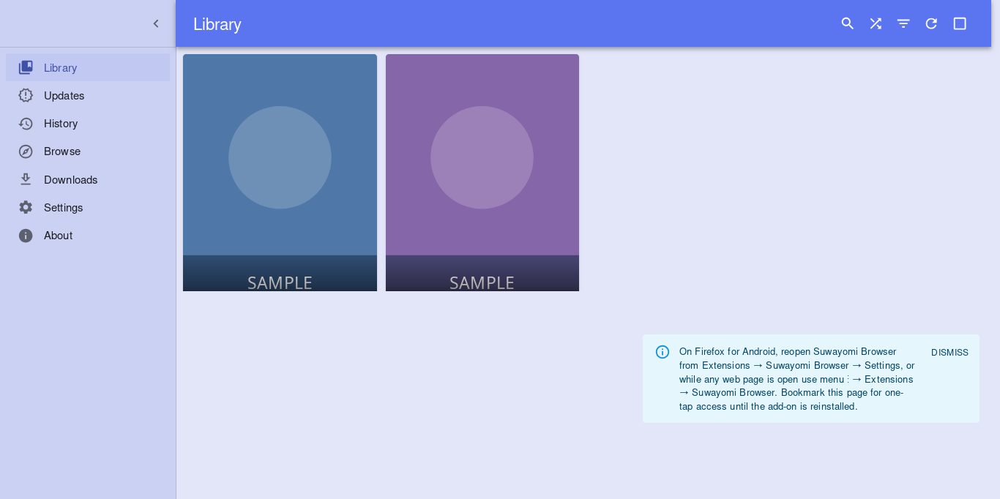
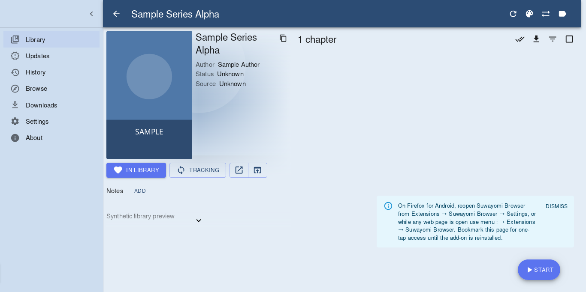

# Suwayomi Browser (unofficial)

A manga and comic reader that runs entirely in your browser. It is the
[Suwayomi](https://github.com/Suwayomi/Suwayomi-WebUI) web interface, but instead of talking to a Suwayomi server, it keeps
everything in the browser. You don't need a server, Java or a desktop app.

Works in Firefox (desktop and Android), Chrome and Edge.

> **Unofficial.** This project is not made or supported by the Suwayomi, Mihon or Tachiyomi teams. It builds on their
> open-source work.

## Install

**Firefox and Firefox for Android:** waiting for review on addons.mozilla.org. The link will be added here once it is approved.

**Chrome and Edge:**

1. Download `suwayomi-browser-0.3.6.zip` from the [latest release](https://github.com/BloodyRedTangerine/suwayomi-browser/releases).
2. Unzip it to a folder you will keep (the browser loads the extension from that folder).
3. Open `chrome://extensions` (or `edge://extensions`), turn on **Developer mode**, click **Load unpacked** and pick the folder.

To update, replace the contents of that folder with the new version and click the reload button on the extension card. Your
library is kept.

## Getting started

The extension comes with no sources and no repositories. To read online content:

1. Open the extension (toolbar button, or on Firefox for Android: menu → Extensions → Suwayomi Browser).
2. Go to Settings → Browse → Extension stores and add a repository URL of your choice.
3. Install the sources you want from Browse → Extensions. The browser asks for access to each site the first time it is needed.

Sources are made by third parties. Only add repositories you trust.

## What works

- Library, categories, reading history, updates and downloads
- Reading offline after downloading
- Backup and restore of your library
- Firefox for Android

## Known limits

- Not every source works. Some need Android features that are not implemented yet.
- Sites that show a "checking your browser" page usually don't work.
- Large libraries can feel slow when saving.

## Privacy

Nothing is sent to the developer. Your library, settings and downloads stay in your browser. The extension only connects to
the repositories and sites you add, and only after you allow each site.

## Reporting a bug

Open an [issue](https://github.com/BloodyRedTangerine/suwayomi-browser/issues). Please include the diagnostics from
Settings → About → **Copy diagnostics**. They contain your browser and extension versions and recent errors, but no titles or
personal data.

For security problems, see [SECURITY.md](SECURITY.md).

## For developers

- How it is built: [docs/BUILDING.md](docs/BUILDING.md). One command with Docker: `docker/build-in-docker.sh ./out`.
- Release packages can be rebuilt byte for byte: [docs/REPRODUCIBLE-BUILD.md](docs/REPRODUCIBLE-BUILD.md).
- How it works inside: [docs/ARCHITECTURE.md](docs/ARCHITECTURE.md).
- Tests: `npm ci && npm test`.

## License and credits

[MPL-2.0](LICENSE). Built on [Suwayomi-WebUI](https://github.com/Suwayomi/Suwayomi-WebUI) and
[Suwayomi-Server](https://github.com/Suwayomi/Suwayomi-Server), [b-jvm](https://github.com/anematode/b-jvm), Zstandard,
QuickJS, fflate and the OpenJDK class libraries (Amazon Corretto). Third-party licenses are included in each package.
